

# Filmroom

**Bring your photos into the film darkroom.**

Native Android film simulation · Offline, on-device processing · No account or ads

[简体中文](README.md) · **English**

[Screenshots & samples](#screenshots--samples) · [Get started](#availability) · [Workflow](#your-first-photo) · [Presets & effects](#presets-and-photo-effects) · [Formats](#supported-formats) · [Build guide](docs/DEVELOPMENT.md)

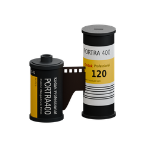
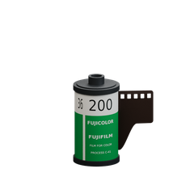
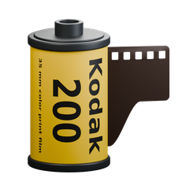
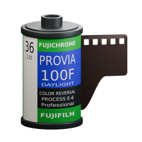
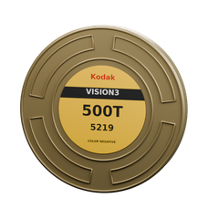
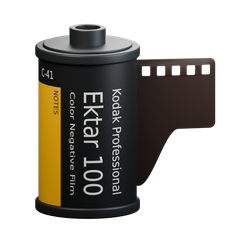

Original artwork used in the app's film selector—not product photographs or before/after samples. [Provenance and trademarks](app/src/main/assets/film-rolls/ASSET_PROVENANCE.md)

## Screenshots & samples

### The app

The photo editor and background export queue in use. Interface details may change between versions.

  <a href="docs/images/showcase/editor.webp">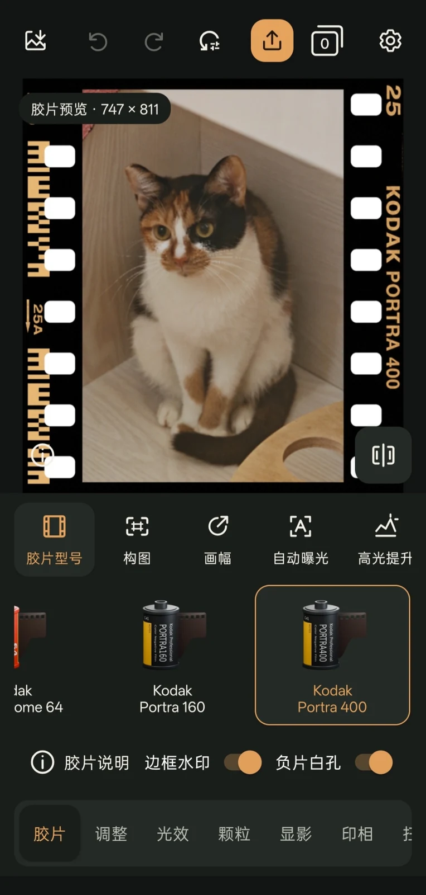</a>
  <a href="docs/images/showcase/export-queue.webp">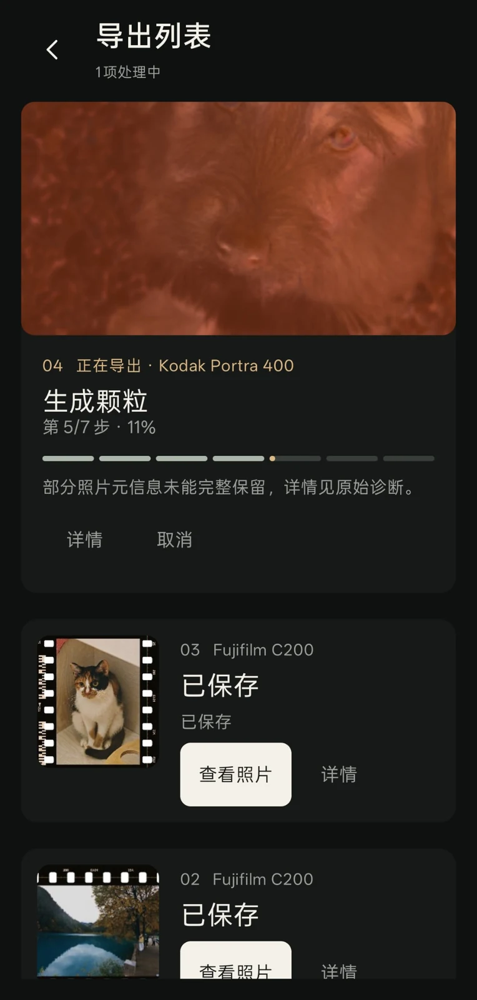</a>

### Samples without frames

The original image proportions, with color, grain and light taking center stage.

  <a href="docs/images/showcase/unframed-sunset.webp">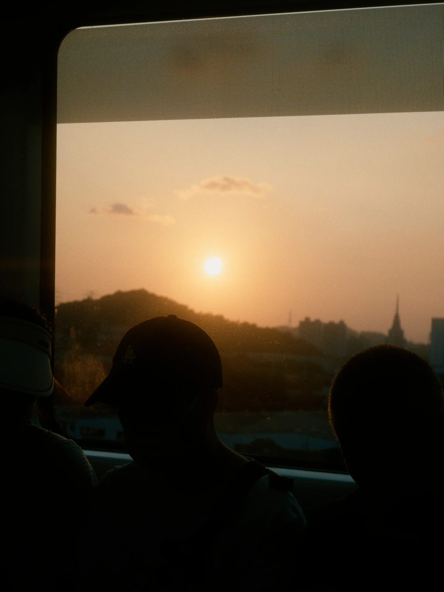</a>
  <a href="docs/images/showcase/unframed-city.webp">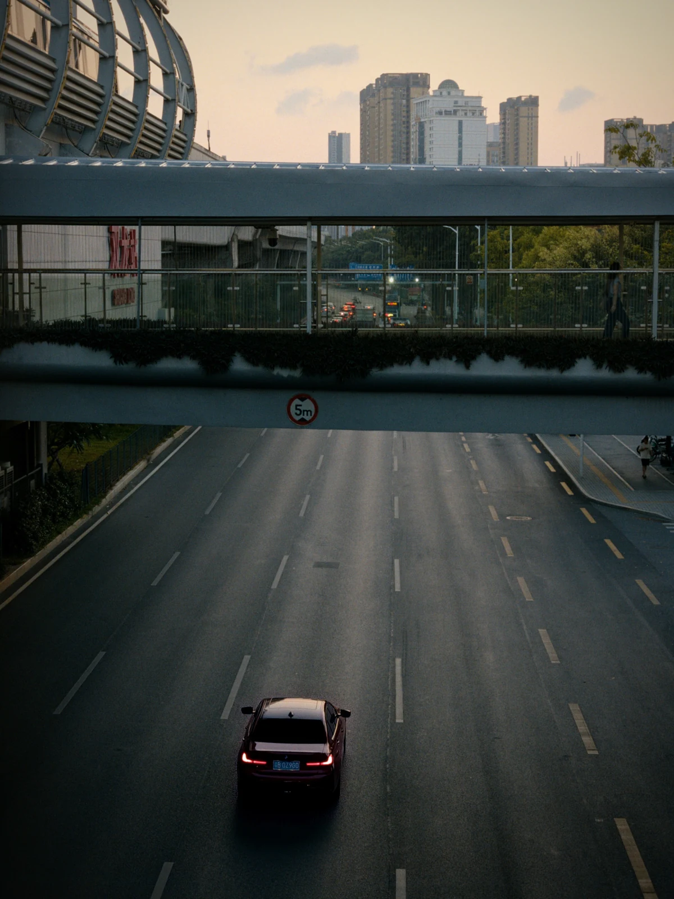</a>
  <a href="docs/images/showcase/unframed-station.webp">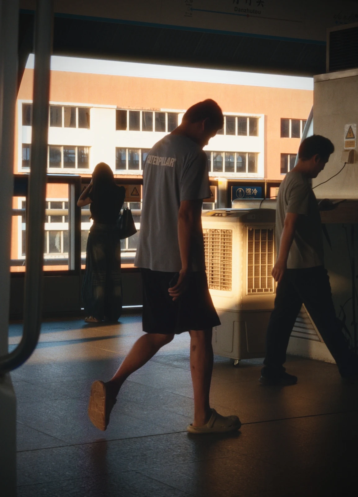</a>

  <a href="docs/images/showcase/unframed-blossoms.webp">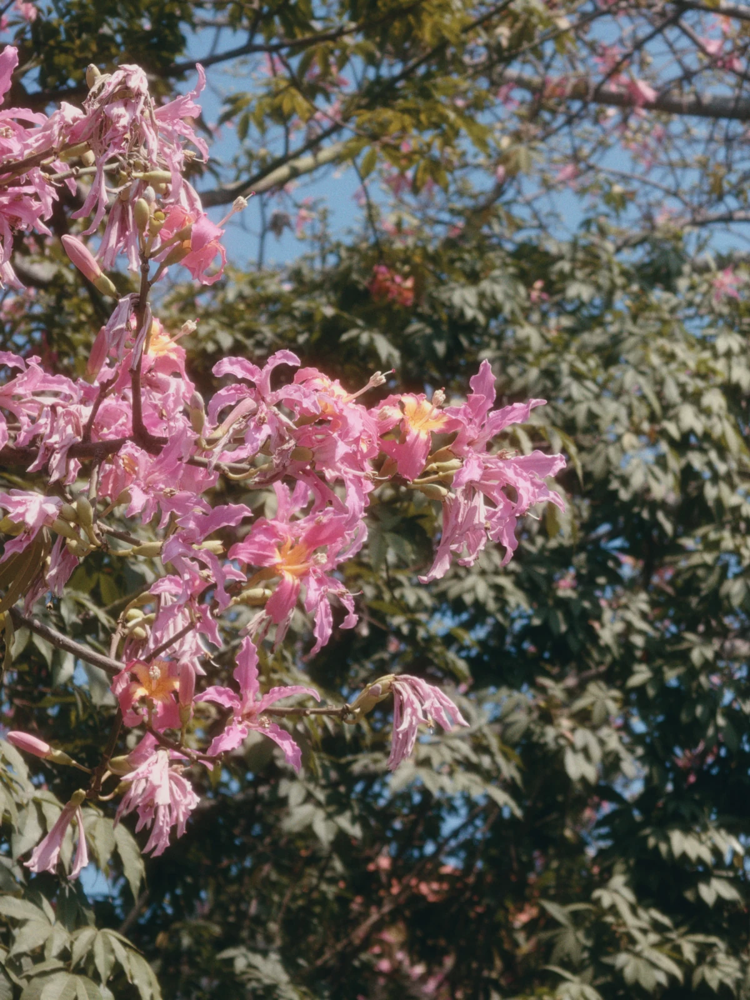</a>
  <a href="docs/images/showcase/unframed-sign.webp">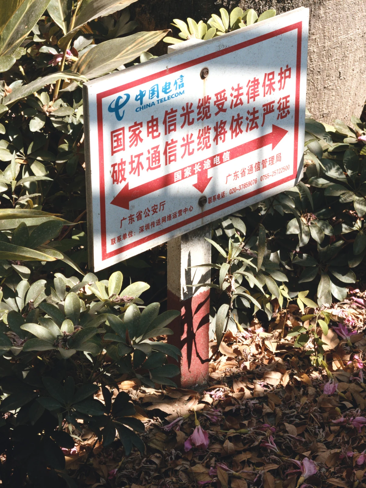</a>

  <a href="docs/images/showcase/unframed-escalator.webp">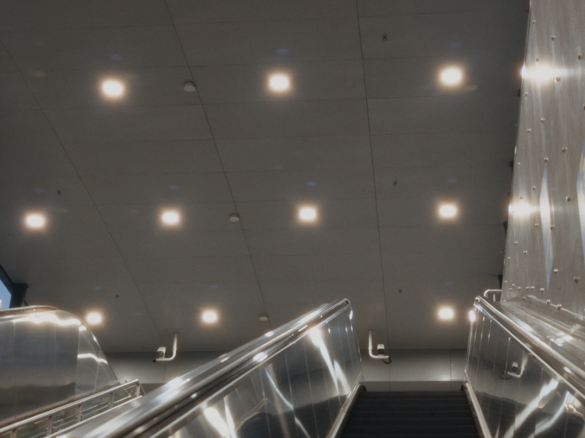</a>

### Samples with film-edge frames

Landscape and portrait compositions, keeping every perforation and the entire frame visible.

  <a href="docs/images/showcase/framed-scooters.webp">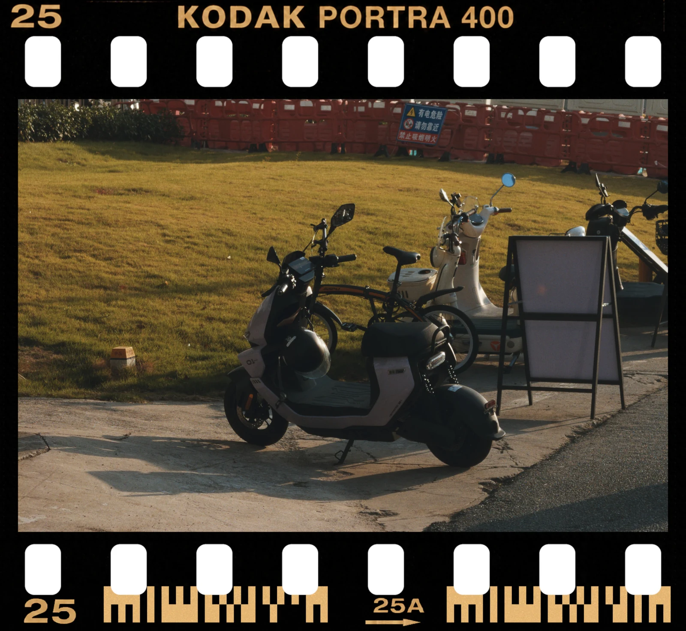</a>
  <a href="docs/images/showcase/framed-interior.webp">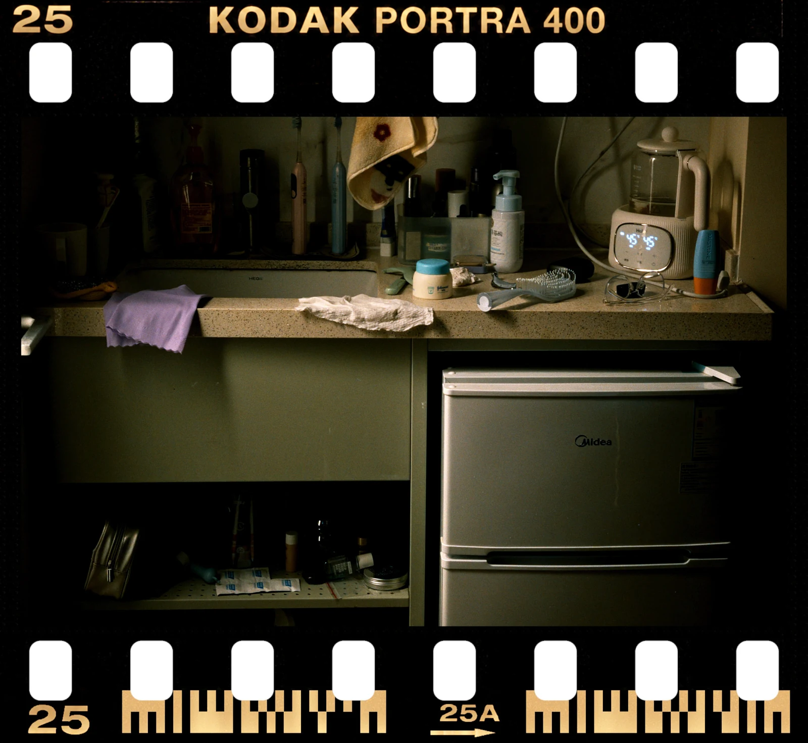</a>
  <a href="docs/images/showcase/framed-garden.webp">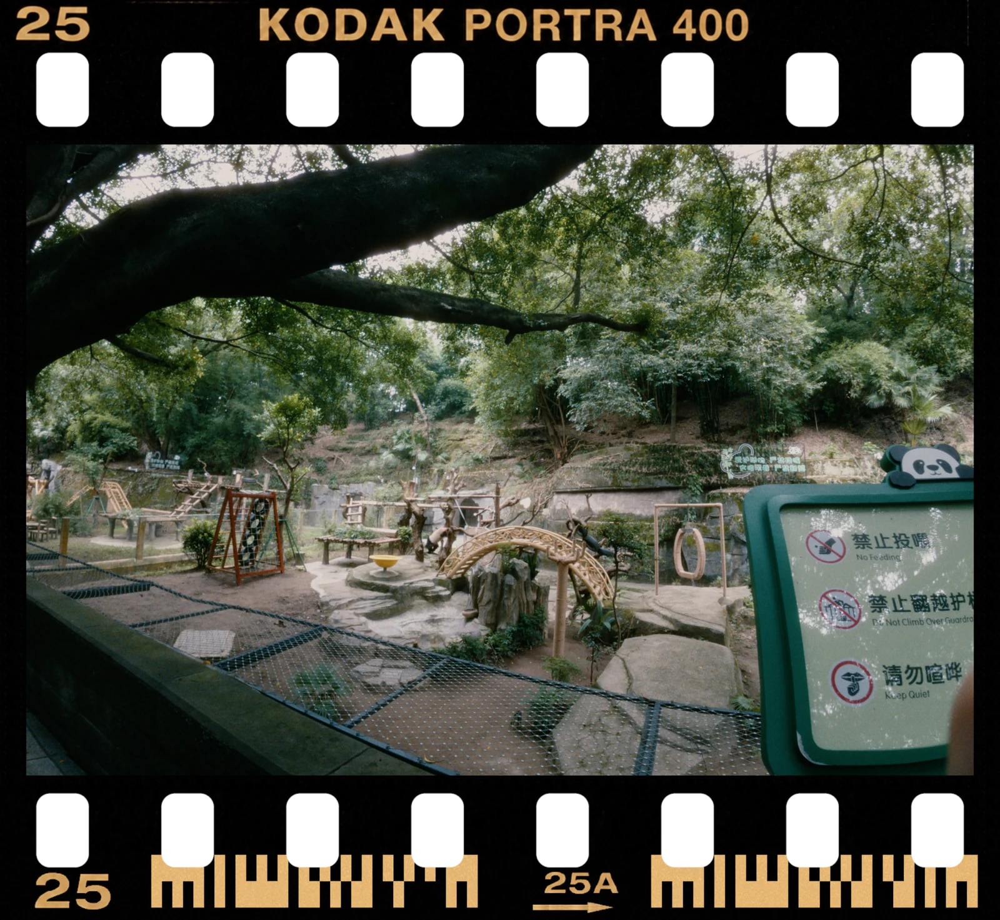</a>

  <a href="docs/images/showcase/framed-dog.webp">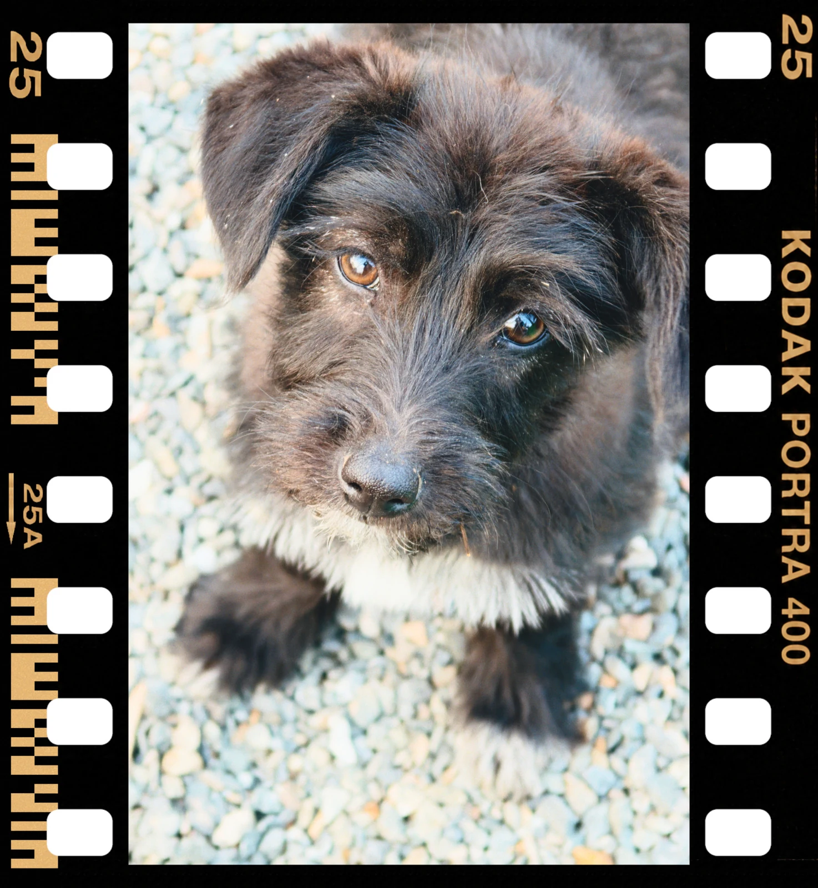</a>
  <a href="docs/images/showcase/framed-cat.webp">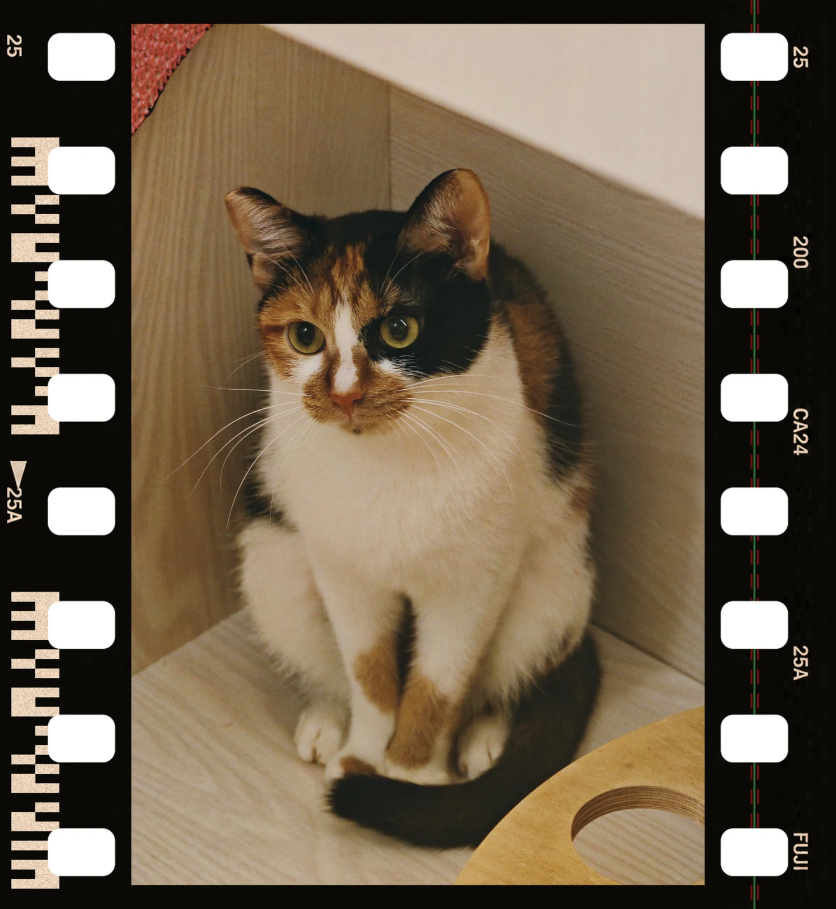</a>

User-provided screenshots and finished photos. Click an image to view it larger. Web copies are resized with metadata removed and no additional color grading. Sample photos retain their full composition; only excess top spacing in the interface screenshots is trimmed. Film edges are app-generated frames, not scans of physical film.

## Start with a roll of film

Filmroom brings film stocks, photographic papers and scanning paths into one mobile darkroom. Choose a stock, shape the exposure, grain and halation, then save a new image. Processing stays on your device, and your original file is never overwritten.

- **Color and monochrome stocks and papers** — Negative, reversal, push and monochrome profiles, including CineStill 800T, Tri-X 400, T-Max 100, Acros II, HP5 Plus and Ilford Multigrade IV RC. Film and paper each have a None option, with illustrated film and paper-package selectors.
- **More than a filter picker** — Film exposure, print or direct-scan rendering, grain, halation and development controls, with original-image comparison, undo and redo.
- **Compose and frame** — Free or fixed-ratio cropping, composition locking, ±15° leveling in 0.1° steps, 135/120 film frames, and date/exposure imprints. Frames and imprints can be composited before film rendering. The luminance histogram measures the preview photo area, excluding frames and imprints; it is not a full-resolution source histogram.
- **Export in the background** — A queue snapshots each image and its settings, reports progress and supports checkpoints with manual resumption after interruption. Android can still stop background work.
- **Save for your next step** — JPEG, PNG or 16-bit TIFF, with sRGB, Display P3 or Adobe RGB (1998) SDR output.
- **Save and share presets** — Name and save editing settings; import preset QR codes using the camera or a gallery image, then confirm and save them.
- **Animate your photos** — Light-table and viewfinder effects with preview, video and Live photo export.
- **Four interface languages** — 中文, English, 日本語 and 한국어, selectable in Settings.

## Availability

**This README covers `dev` source version 0.1.22-beta22 (versionCode 74, `0762a9f`).** Development and stable builds may differ. Check [GitHub Releases](https://github.com/rasang/filmroom/releases) for available APKs, or [build from source](docs/DEVELOPMENT.md) (Chinese guide). Candidate changes not yet merged into this branch are outside this scope.

- Requires **64-bit Android 10 (API 29) or later**. Source builds include ARM64 and x86_64 by default; an ARM64-only phone build is also available.
- This is an early-stage project. Host builds, algorithm checks and JNI/UI tests exist, but **end-to-end testing on physical Android devices is not complete**. No phone performance or battery-life guarantees are made.
- Versions through 0.1.16 used the old debug certificate. Version 0.1.17 starts a new fixed release certificate; see the migration notice below. Keep your own signing key; source release builds are unsigned by default.

See [0.1.20 notes](docs/RELEASE_0_1_20.md) for JPEG XL DNG, medium-format and composition changes. See [0.1.19 notes](docs/RELEASE_0_1_19.md) for RAW, HEIC, monochrome film, detail-preview and export-history changes. [0.1.18 notes](docs/RELEASE_0_1_18.md) retain the earlier interface changes.

## Your first photo

1. **Import** — Choose one photo through the system gallery or file picker. Use the file picker for RAW; see compatibility below.
2. **Choose a stock and adjust** — Tap a film stock, tune exposure, grain and halation, then choose a print/direct-scan path, crop or add a frame as needed. Compare with the original as you work.
3. **Export a new file** — Choose a format, size and color space, then add it to the queue. JPEG/PNG files go to the gallery's “暗房” album; TIFF files go to “Downloads/暗房”.

> **Batch exports and heat:** Processing multiple photos continuously puts sustained load on your phone. It may become noticeably hot, use more battery and slow down as the system thermally throttles. Export in smaller batches; if the phone becomes noticeably hot, stop processing and let it cool before continuing.

The [user guide](使用说明.txt) is currently in Chinese. Exports retain supported capture metadata, **including existing GPS and author information**—check before sharing publicly. See the [metadata rules](docs/EXPORT_METADATA.md) for details.

## Presets and photo effects

### Save your darkroom recipe

Name, save, load or delete presets, generate a sharing image/QR code, and import codes from the camera or gallery. Import requires confirmation and saves a preset; it does not immediately overwrite the current edit.

Presets include film, paper, color, grain, composition/leveling, frame and date/exposure-imprint settings, **not the photo itself**. Applying a preset to another photo also reuses its saved composition and custom date; adjust them as needed. See [presets](docs/SAVED_PRESETS.md) and [QR sharing](docs/PRESET_QR_SHARING.md).

### Light table and viewfinder

| Light table: illumination | Viewfinder: focus, shutter and reveal |
| --- | --- |
| [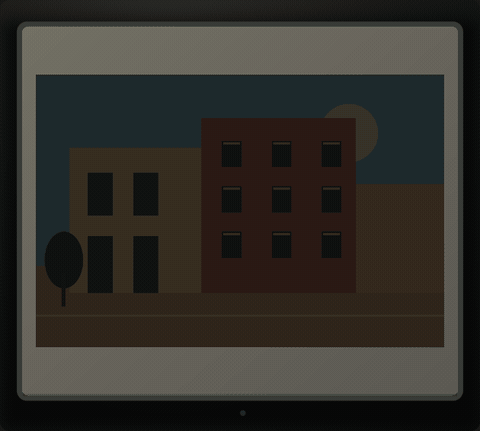](docs/assets/effects/light-table.mp4) | [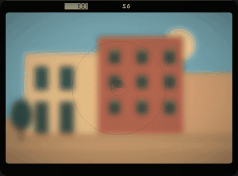](docs/assets/effects/viewfinder.mp4) |

[Light-table MP4](docs/assets/effects/light-table.mp4) · [Viewfinder MP4](docs/assets/effects/viewfinder.mp4)

*Silent, 3-second looping previews. Rendered offscreen using this branch's actual effect shaders, textures and timeline with an original example illustration; not a phone recording or a device-performance claim. GIFs display directly in the README; click for 30 fps MP4. [Provenance and generation notes](docs/assets/effects/README.md).*

Open photo effects from export history. Each sequence is approximately 3 seconds:

- **Light table:** Simulated illumination and film viewing. When paging, the table stays fixed while the film slides; portions outside the illuminated area darken.
- **Viewfinder:** Nikon F3-inspired shutter/aperture readouts, blurred-to-sharp split-image focus and mirror occlusion. Portrait compositions place the readouts on the right and rotate the split-image and mirror directions accordingly.
- **Browse and replay:** The entry photo plays once automatically. Swiping, including returning to the first photo, does not autoplay; use Replay. Distance or a deliberate fast flick can change pages. Adjacent preloading and a bounded cache reduce decoding; low-memory conditions or leaving the page can still require a reload, and zero latency is not guaranteed.
- **Original comparison:** Uses the composition/leveling snapshot saved with that export, rather than the uncropped original. Older records without that information cannot guarantee the same composition.
- **Sound and export:** Preview and video/Live exports use focus beeps, a mechanical shutter or light-switch sound, plus subtle noise with fades at the ends. Choose original size, a 1920-pixel or 1080-pixel long edge. Encoder/resource limits can cause a fallback; see [export diagnostics](docs/EFFECT_EXPORT_DIAGNOSTICS.md).

**Live scope:** This packages an effect as a Live photo; it does not mean the app can read embedded videos from other brands' Live originals. Photo import still reads a static image. Gallery recognition, audio playback and encoder support require device testing; compatibility with every brand/gallery is not guaranteed.

## Backup, deletion and updates

- **Local backup:** Settings can export/restore a ZIP containing supported preferences, presets, export records and photo-access links, **not the source or exported image files**. Restore requires confirmation. Reinstallation may require renewed photo permission or relinking; this does not recover missing photos or running export jobs. Backups are unencrypted and contain records/access links, so store them carefully.
- **Deletion confirmation:** A remembered deletion scope now gets a confirmation stating that scope. Without a remembered scope, the existing scope-selection dialog remains the confirmation, without an extra duplicate prompt.
- **Update checks:** Check manually in Settings, or through rate-limited cold-start checks. The update dialog shows notes and download links that open in the browser; the app does not automatically download or install APKs.

## Supported formats

| Input | Current scope |
| --- | --- |
| JPEG / PNG | System decoding; transparent PNG areas are composited over white. |
| HEIC | A limited subset of ordinary, static 8-bit HEVC primary/grid images; requires a device decoder and sufficient memory. Supported P3 input is converted to sRGB SDR, not edited as HDR. |
| NEF / CR2 / ARW | Implemented tested ordinary Bayer, Canon mRAW/sRAW, Nikon HE/HE* and small NEF, and Sony reduced-size/ARW6 branches. Decodes actual pixels, never an embedded-preview substitute. Encoding and resource limits are described below. |
| Canon CR3 | Bounded sensor decoding for supported single-still RAW / C-RAW layouts, never an embedded-JPEG preview substitute. Unsupported or unverified burst and multi-sample layouts remain rejected. |
| Olympus / OM System ORF / ORI | Content-based identification and decoding of supported Bayer sensor layouts. ORI uses the same ORF decoder; this does not cover every high-resolution mode, and 80 MP files remain above the import limit. |
| Pentax PEF | Bounded Bayer RAW decoding. Unsupported or unverified pixel-shift, HDR-composite and monochrome variants remain rejected. |
| RAF | Bounded basic Fujifilm Bayer/X-Trans candidate with tested uncompressed, lossless and lossy samples; original pixels and EXIF are retained. See [RAF scope](docs/FUJIFILM_RAF.md) for tested modes, GFX/legacy limits and validation status. |
| DNG | Adds constrained 16-bit three-channel LinearRaw JPEG XL strips; see [JXL scope](docs/JPEG_XL_DNG.md).  Existing 16-bit paths plus validated 12/14-bit three-channel LinearRaw SOF3 strips. Four public S23-family samples passed full-frame raw/linear-color host comparisons; only one is confirmed Expert RAW. Not blanket brand/mode support. |
| Panasonic RW2 | 13 samples cover v4, v5 (14-bit), v6, v7 (14-bit) and constrained v8/CF2, including tested modes from GH6, S5 II X, G9 II, GH7 and S1R II. Special encodings and oversized files may still be rejected; see [limits](codecs/README.md). |

| Output | Best for |
| --- | --- |
| JPEG · 8-bit | Everyday sharing; quality 1–100, default 95. |
| PNG · 8-bit | Avoiding another JPEG compression pass; does not recover missing input precision. |
| TIFF · 16-bit | Further editing; larger files, not displayed by every gallery. An 8-bit source does not become RAW. |
| MP4 / Live photo | Export from the photo-effects page; encoder, gallery and audio-playback limitations are described above. |

**Know the limits:** A `.dng` extension does not guarantee compatibility. HEIC export, other unlisted camera RAW formats, AVIF, EXR and HDR enhancement/preservation are not implemented. RAW/HEIC import is limited to 52 megapixels; final encoding is limited to 84 megapixels, subject to format, memory and storage constraints. Zoomed previews have a maximum long edge of 1536 pixels—**not source-resolution detail**. Unsupported variants or insufficient memory/temporary storage produce an explicit failure, rather than silently downsizing a full-resolution export.

**Camera RAW scope:** The list describes tested formats and pixel layouts, not a camera-model allowlist. Identification uses file contents and offline color profiles, not the suffix alone. It does not guarantee every unknown camera, future compression variant or damaged file. Basic matrix development does not reproduce camera styles; small NEF uses an independently verified already-balanced linear-sRGB path without applying white balance twice. Host validation is not physical Android-device validation.

Detailed contracts: [HEIC](docs/HEIC_IMPORT.md) · [DNG/codecs](codecs/README.md) · [Xiaomi DNG scope](docs/XIAOMI_DNG_COMPAT.md) · [Previews](docs/LOCAL_DETAIL_UI.md). These technical documents are primarily in Chinese.

## Your photos stay on your device

Photo processing stays on the device, without accounts or automatic photo uploads. Network permission is used for manual or rate-limited cold-start update checks. Camera permission is used when you choose to scan a code; restoring photo access may request photo-library permission. Normal imports use the system picker. Temporary files stay in app-private storage. Automatic Android app backup is disabled; manual ZIP backups are initiated by you in Settings.

For troubleshooting, manually share a redacted TXT from Diagnostic Logs and describe your version, device and reproduction steps in [Issues](https://github.com/rasang/filmroom/issues). Logs exclude photos, filenames, GPS and paths. Sharing is your choice; nothing is uploaded automatically.

## Development and documentation

Native Kotlin Android UI with Rust/JNI image-processing and codec components. Image processing runs offline; update checks and first-time build dependency resolution may need internet access.

- [Build guide](docs/DEVELOPMENT.md) (Chinese): prerequisites, builds, replacing native components and verification scope.
- [Effect audio setup](docs/EFFECT_AUDIO_SETUP.md) (Chinese): the public repository does not include standalone mixed tracks containing third-party recordings. Obtain and generate them under their source licenses; a source checkout alone does not reproduce release audio. Prepare native JNI libraries using the build guide too.
- [Effect paging and caching](docs/EFFECT_PAGE_CACHE_BETA22.md): cache ownership, flick gestures, shutter-digit spacing and validation boundaries.
- [Development history](docs/HISTORY.md) (Chinese): the complete previous README through 0.1.16, including changes and validation limits.
- [Validation record](验证记录.md) (Chinese): tests performed and device workflows not yet covered.

## Credits and licensing

Filmroom's film and paper engine builds on Andrea Volpato's [spektrafilm](https://github.com/andreavolpato/spektrafilm) and the [spektrafilm-rs](https://github.com/turbasvin/spektrafilm-rs) Rust port.

Code is licensed under [GPL-3.0](LICENSE). The relevant film profiles and LUT data are licensed under **CC BY-SA 4.0**; see the [upstream license and data notices](app/src/main/assets/licenses/SPEKTRAFILM_LICENSE.txt). Other components retain their own [licenses and notices](app/src/main/assets/licenses). The reset-settings icon comes from [Material Symbols](third-party/material-symbols-reset-settings/NOTICE.txt).

The film-selector illustrations are original project artwork. Film-edge frames include reference-based redraws and modeled interpretations, not original film scans; [artwork documentation](docs/FILM_STOCK_ARTWORK.md) records provenance and limitations. Kodak, Fujifilm and film-stock names belong to their respective owners and identify profiles only, without affiliation or endorsement.

## Signing migration in 0.1.17

This version uses a new fixed release certificate. Upgrading from 0.1.16 or earlier requires uninstalling the old app first: private edit settings, temporary photos and export queues are removed; images already saved to the system gallery/downloads remain. Future versions using this same certificate can update in place. Source builds are unsigned by default. See [release notes](docs/RELEASE_0_1_17.md).

