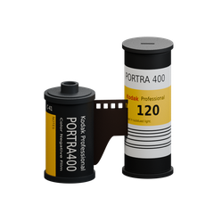
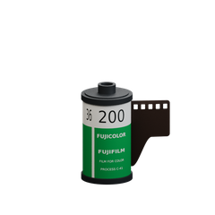
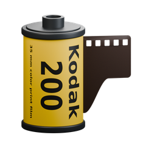
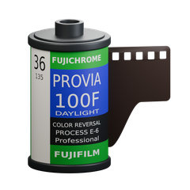
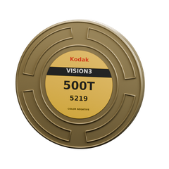
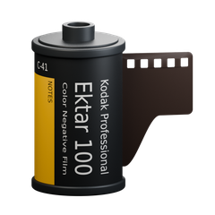

# Filmroom

**把照片带进胶片暗房。**

原生 Android 胶片模拟 · 本机离线处理 · 无账号、无广告

**简体中文** · [English](README.en.md)

[安装与版本](#安装与版本) · [开始使用](#开始使用) · [格式支持](#格式支持) · [开发指南](docs/DEVELOPMENT.md)

应用内的原创胶卷选择素材；不是实物照片或成像效果对比。[素材来源与品牌说明](app/src/main/assets/film-rolls/ASSET_PROVENANCE.md)

## 从选一卷胶片开始

Filmroom 将胶片、相纸与扫描路线放进手机上的同一间暗房：选一卷胶片，调整曝光、颗粒与光晕，再把成片保存为新文件。照片始终在本机处理，原文件不会被覆盖。

- **18 款胶卷，20 个胶片配置** — 包含彩色负片、反转片及 Portra 800 的两档推片配置；另有 6 种相纸、2 种电影拷贝片配置。
- **不止选一个滤镜** — 胶片曝光、印相或底片直扫、颗粒、光晕与显影控制，搭配原片对比、撤销和重做。
- **构图与边框** — 自由或比例裁剪、构图锁定，以及可选的胶片边框水印与负片白孔表现。
- **导出留给后台** — 队列保存照片与参数快照，显示处理进度；支持阶段检查点和中断后手动继续。系统仍可能停止后台任务。
- **按用途保存** — JPEG、PNG 或 16 位 TIFF；可选 sRGB、Display P3、Adobe RGB (1998) SDR 输出。
- **用熟悉的语言编辑** — 中文、English、日本語、한국어，可在设置中切换。

## 安装与版本

**当前源码版本：0.1.17。** 安装包将通过 [GitHub Releases](https://github.com/rasang/filmroom/releases) 提供；具体可下载版本以 Releases 页面为准。现在可以按[开发指南](docs/DEVELOPMENT.md)自行构建。

- 面向 **Android 10（API 29）及以上的 64 位设备**；源码默认构建 ARM64 和 x86_64，可单独构建 ARM64 手机包。
- 项目仍处于早期体验阶段。已有主机构建、算法及 JNI/UI 测试，**尚未完成 Android 真机全流程验证**，不作手机速度或耗电保证。
- 0.1.17 改用固定发行签名；与 0.1.16 及更早体验包不同，首次须卸载旧版再安装，应用内参数、临时照片和队列会清除，已保存相册成片不受影响。之后同签名版本可覆盖升级。自行构建需使用自己的密钥；Release 构建默认未签名。详见[迁移与更新说明](docs/RELEASE_0_1_17.md)。

## 开始使用

1. **导入照片** — 从系统「相册」或「文件」选择一张照片。DNG 请从文件入口选择；兼容范围见下表。
2. **选择胶片与调整** — 点选胶卷，调整曝光、颗粒和光晕；按需切换印相/直扫路线、裁剪或添加边框，用「对比」查看原片。
3. **导出新文件** — 选择格式、尺寸与色域，加入导出队列。JPEG/PNG 保存到相册「暗房」，TIFF 保存到「下载/暗房」。

> **批量导出与发热：** 持续处理多张照片会让手机保持较高负载，可能明显发热、增加耗电，并因系统温控降频而变慢。建议分批导出；发热明显时暂停处理，让机身降温后再继续。

完整参数说明见[使用说明](使用说明.txt)。导出会保留支持的拍摄元信息，**包括原有 GPS 和作者信息**；公开分享前请留意，详见[元数据规则](docs/EXPORT_METADATA.md)。

## 格式支持

| 输入 | 当前范围 |
| --- | --- |
| JPEG / PNG | 系统解码；PNG 透明区域合成到白色背景。 |
| HEIC | 受限的普通静态 8 位 HEVC 主图/网格图；依赖设备解码器及足够内存。支持范围内的 P3 转为 sRGB SDR，不是 HDR 编辑。 |
| DNG | 受限的 16 位未压缩条带式拜耳/线性 RGB，以及已验证的无损 JPEG（SOF3）条带/平铺类型；读取 RAW 数据，不以嵌入预览代替。 |

| 输出 | 适合用途 |
| --- | --- |
| JPEG · 8 位 | 通用分享，质量 1–100，默认 95。 |
| PNG · 8 位 | 避免再次 JPEG 压缩；不恢复输入中不存在的精度。 |
| TIFF · 16 位 | 继续后期，文件较大；部分相册无法显示。8 位输入不会因此变成 RAW。 |

**使用前请知道：** DNG 后缀不代表一定兼容；HEIC 导出、其他相机 RAW、AVIF、EXR 和 HDR 增强/保存尚未接入。DNG/HEIC 导入上限为 5200 万像素，最终编码上限为 8400 万像素，仍受格式、内存与空间限制。局部放大预览最长边仍为 1536 像素，**不是原图像素级预览**。不支持的文件变体或内存/临时空间不足时会明确停止，不暗中缩图完成原尺寸导出。

详细范围：[HEIC](docs/HEIC_IMPORT.md) · [DNG 与编解码器](codecs/README.md) · [小米 DNG 适配边界](docs/XIAOMI_DNG_COMPAT.md) · [预览](docs/LOCAL_DETAIL_UI.md)。

## 照片只留在你的设备上

应用没有网络权限、账号或上传功能，也不请求整个相册的读取权限。只读取系统选择器授权的照片，处理临时文件保存在应用私有目录，应用备份关闭。

遇到问题，可在「诊断日志」中手动分享脱敏 TXT，再到 [Issues](https://github.com/rasang/filmroom/issues) 描述版本、设备和复现步骤。日志不包含照片、文件名、GPS 或路径；分享动作由你发起，不会自动上传。

## 开发与文档

原生 Kotlin Android 界面，Rust/JNI 图像引擎与编解码组件。应用运行离线；首次构建依赖解析可能需要联网。

- [开发指南](docs/DEVELOPMENT.md)：环境准备、构建、原生组件替换与验证范围。
- [历史开发记录](docs/HISTORY.md)：截至 0.1.16 的完整旧 README，保留版本变更和验证限制。
- [验证记录](验证记录.md)：已执行的测试及未覆盖的设备流程。

## 开源来源与许可

Filmroom 的胶片与相纸引擎基于 Andrea Volpato 的 [spektrafilm](https://github.com/andreavolpato/spektrafilm) 及 [spektrafilm-rs](https://github.com/turbasvin/spektrafilm-rs) 的 Rust 移植工作。

程序代码遵循 [GPL-3.0](LICENSE)；相关胶片档案与 LUT 数据遵循 **CC BY-SA 4.0**，见[上游许可与数据声明](app/src/main/assets/licenses/SPEKTRAFILM_LICENSE.txt)。其他组件保留各自的[许可和声明](app/src/main/assets/licenses)，恢复预设图标来自 [Material Symbols](third-party/material-symbols-reset-settings/NOTICE.txt)。

胶卷选择插画为项目原创素材，边框包含参考重绘与模型化表现，并非原始胶片扫描；[素材说明](docs/FILM_STOCK_ARTWORK.md)保留来源与限制。Kodak、Fujifilm 及胶片名称归各权利人所有，仅用于识别配置，不表示合作或背书。
